# AI Grading Assistant — Project Showcase

**AI-assisted grading platform for programming assignments (Python, SQL, Front-End, Java/Hibernate).**
Student code is executed in isolated Docker sandboxes; an LLM (Google Gemini) grades against the trainer's rubric using
that real evidence; trainers review every score before it is published to students.

> **About this repository.** This is a team project built during **On-the-Job Training (OJT) at FPT Software Academy
> (FSA)**, Ho Chi Minh City (Group 04, 14/09/2026 – 12/12/2026). The source code and the course data are **not public**. This repository only presents the project:
> architecture, grading flow and screenshots. **All screenshots use synthetic sample data** (students SV001–SV003, sample
> assignments written for the demo). A live demo or code walkthrough is available on request during an interview.

**Author:** Phan Gia Khanh — final-year Software Engineering student (Data Science specialization) at FPT University;
team leader and main developer of a 4-member team (~70% of the commits in the team repositories).

---

## Highlights

| | |
|---|---|
| **4 assignment types** | Python, SQL (PostgreSQL), Front-End (HTML/CSS/Bootstrap/jQuery), Java / Hibernate |
| **4 execution sandboxes** | Python unit tests · SQL result comparison · Maven/javac compilation · headless Chromium screenshots |
| **Backend** | FastAPI, 68 REST endpoints, 20-table PostgreSQL schema, JWT + role-based access |
| **Validated on real coursework** | 105/105 Java/ORM projects compiled (1,216 source files), 30 front-end projects rendered |
| **Quality** | ~200 automated test cases (API, sandbox, security / attack suites) |
| **AI cost control** | API-key pool with per-model quota tracking, quota-aware batch grading, result cache (re-grading = 0 API calls) |

## Architecture

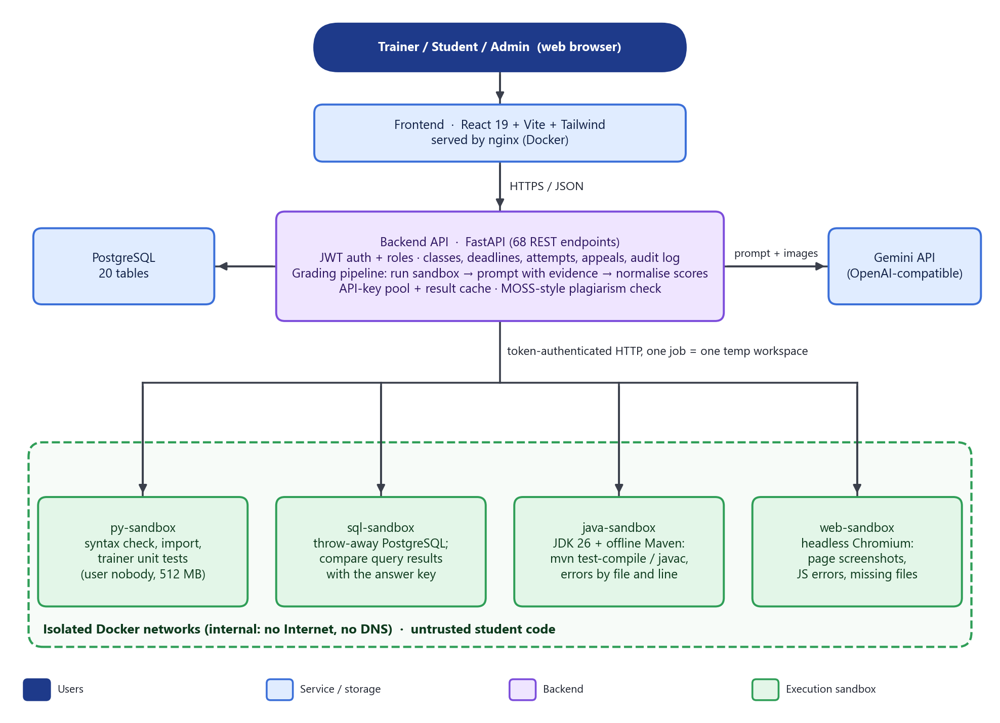

- **Frontend:** React 19 + Vite + Tailwind CSS (light / dark theme), served by nginx.
- **Backend:** FastAPI; classes with join passwords, deadlines, attempt limits, grade audit log, appeals, side-by-side
  code comparison, Excel gradebook export, admin page.
- **Database:** PostgreSQL.
- **LLM:** Gemini through an OpenAI-compatible API; text + image (multimodal) prompts.
- **Sandboxes:** one container per language on private Docker networks.

## How grading works

1. The trainer clicks **Grade with AI** (one submission or a whole class in batch).
2. The backend sends the submission to the matching **sandbox** and gets objective evidence:
   - **Python:** syntax check, import check, the trainer's unit tests → PASS / FAIL / ERROR per test.
   - **SQL:** the script runs in a throw-away PostgreSQL database; each query result is compared with the answer key on
     the same sample data.
   - **Java / Hibernate:** offline `mvn test-compile` or `javac` with JDK 26 → compile errors by file and line.
   - **Front-End:** each page is opened in headless Chromium → screenshots, JavaScript errors, missing CSS/JS files.
3. The LLM receives the assignment, rubric, source code **and the sandbox evidence** (plus page screenshots and the
   assignment's design images for front-end work) and returns a score and comment per rubric criterion.
4. Scores are normalised server-side, plagiarism is checked (MOSS-style token winnowing), and the result waits for the
   trainer's review. Students only see scores after the trainer publishes them.

| Python grading flow | Front-End grading flow |
|---|---|
| 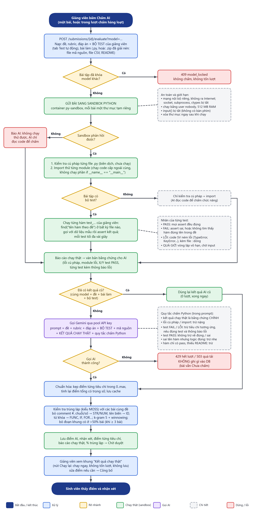 | 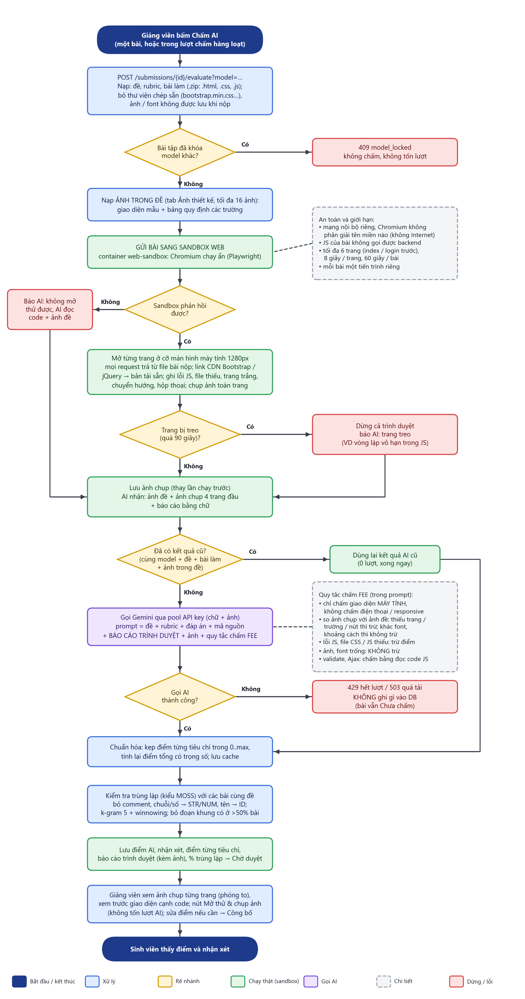 |

## Sandbox security

Student code is untrusted, so every sandbox is hardened:

- private Docker networks with **no Internet and no DNS**; the web sandbox serves every request from the submission itself;
- read-only filesystem, code runs as the unprivileged `nobody` user, dangerous Python modules disabled;
- CPU / RAM / process limits, per-test and per-job timeouts, the whole process group is killed on timeout;
- one temporary workspace per job, deleted afterwards; token-authenticated API between backend and sandboxes;
- verified with an attack test suite (network access, privilege escalation, infinite loops, fork bombs).

## Screenshots (synthetic sample data)

**Login**
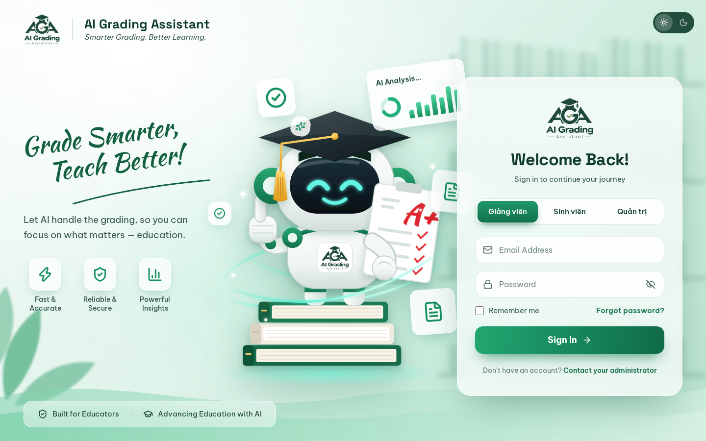

**Classes — trainer view**
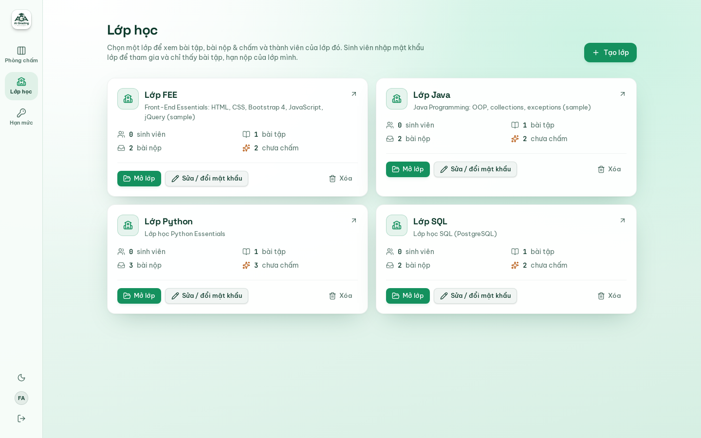

**Python: trainer's automated test suite**
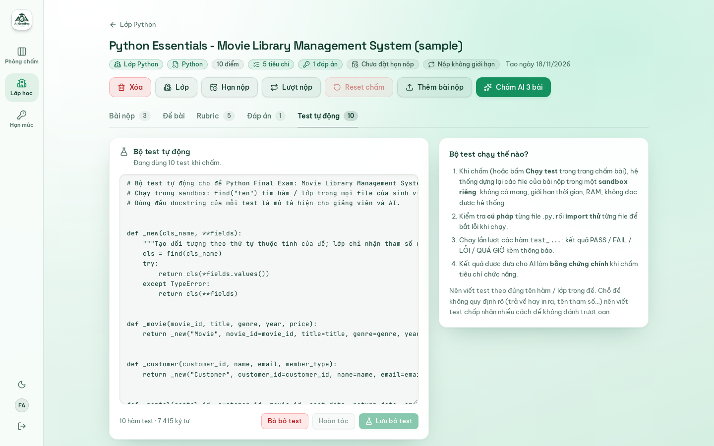

**Python: real test results in the grading view (7/10 PASS for a partial submission)**
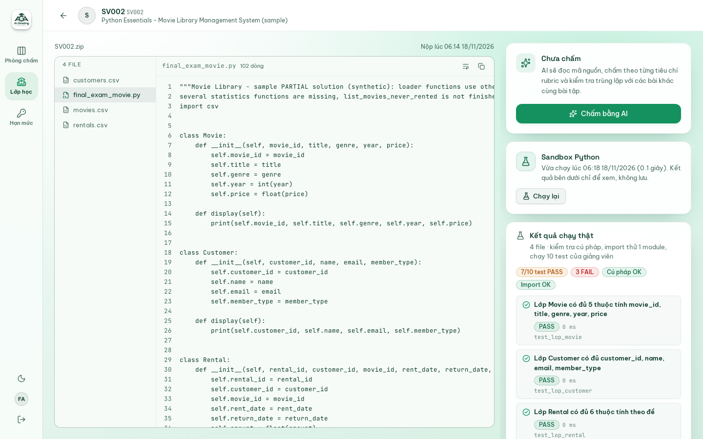

**SQL: automatic comparison with the answer key (1/5 queries match)**
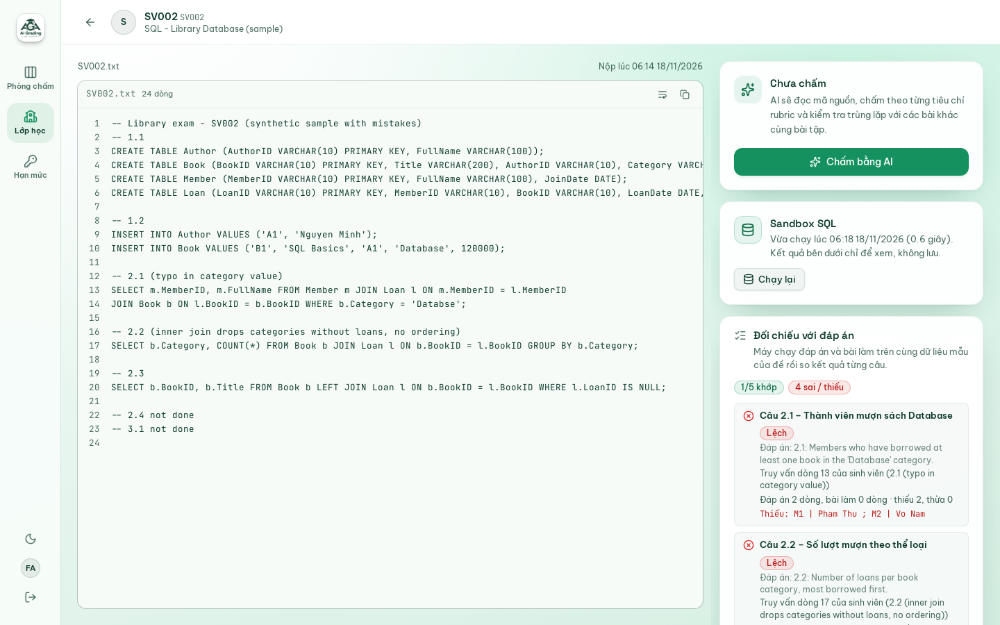

**Java: real compilation, error located by file and line**
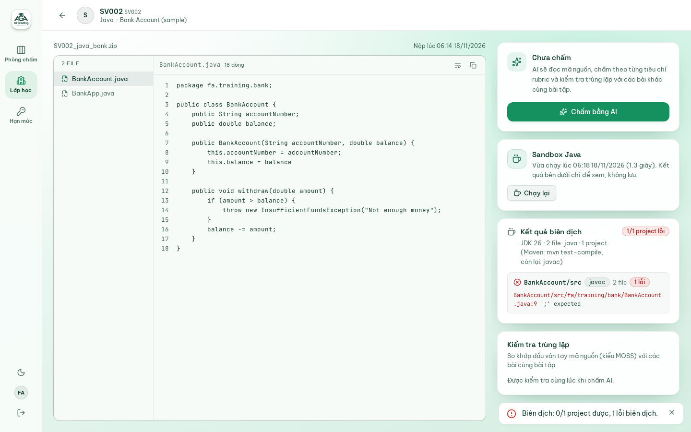

**Front-End: live preview next to the code, browser screenshots for the AI**
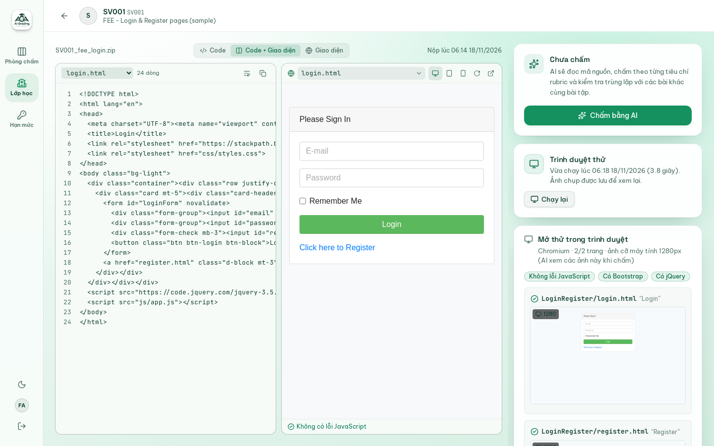

**Dark theme**
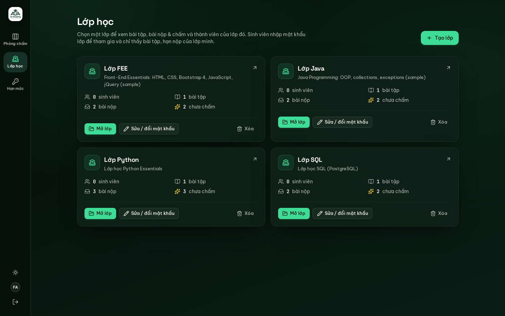

## Tech stack

Python · FastAPI · Pydantic · PostgreSQL · React 19 · Vite · Tailwind CSS · Docker / Docker Compose · Playwright
(headless Chromium) · JDK 26 / Maven · Google Gemini (OpenAI-compatible API) · JWT · bcrypt · Git / GitLab ·
AI-assisted development with Claude Code

---

### Tóm tắt (Tiếng Việt)

Nền tảng chấm bài lập trình bằng AI (Python, SQL, Front-End, Java/Hibernate), làm trong thời gian OJT tại
FPT Software Academy (FSA), TP. Hồ Chí Minh (nhóm 04, 14/09/2026 – 12/12/2026). Bài làm được **chạy thật** trong 4 sandbox Docker cách ly; AI chấm theo rubric dựa trên kết quả
chạy thật; giảng viên duyệt trước khi công bố điểm. Mã nguồn và dữ liệu khóa học **không công khai**; repo này chỉ giới
thiệu dự án, mọi ảnh chụp dùng **dữ liệu mẫu tự tạo**. Có thể demo trực tiếp khi phỏng vấn.
